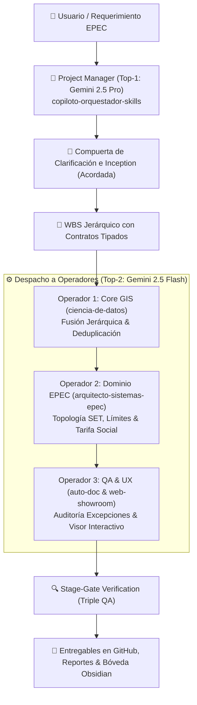

# 🧭 Arquitectura del Squad Ágil & Gobernanza del Proyecto

## 1. Misión y Arquetipo Operativo
El presente proyecto fue gestionado y ejecutado bajo la modalidad del **Squad Ágil Multi-Agente PM-Operadores** configurado para el **Arquetipo A (GIS, Catastro y Redes Eléctricas EPEC)**, en estricto cumplimiento del protocolo rector [`docs/Protocolo-Arquitectura-Multi-Agente-PM-Operadores.md`](file:///D:/Proyectos/antigravity-agents-repository/docs/Protocolo-Arquitectura-Multi-Agente-PM-Operadores.md).



---

## 2. Ranking Dinámico de Modelos Gemini

Siguiendo la regla de adaptabilidad multi-generacional, se auditaron los modelos disponibles en su configuración más alta (`High` / `Thinking`):

| Puesto | Modelo Evaluado | Configuración | Rol Asignado en el Squad |
| :---: | :--- | :---: | :--- |
| **Top-1** | **Gemini 2.5 Pro** | *High Thinking / Pro* | **Project Manager (PM)**: Planificación, arbitraje y control Stage-Gate. |
| **Top-2** | **Gemini 2.5 Flash** | *High Execution / Flash* | **Operadores 1, 2 y 3**: Ejecución técnica, red-teaming y visualización. |
| Alt-1 | Gemini 2.0 Flash | *Standard* | Reserva / Subagentes secundarios de consulta rápida. |
| Alt-2 | Gemini 1.5 Pro | *Legacy* | Respaldo ante contingencias de cuota. |

---

## 3. Matriz de Contratos Tipados y WBS Hand-off

```text
WBS-SET-01 [Operador 1] -> Ingesta parcelaria, fusión jerárquica y deduplicación por manzana.
    * Input: padron_nuevas_rutas_provincial_consolidado.parquet
    * Output: data/capa_parcelas_general_consolidada.parquet (386,005 parcelas únicas)
    * QA: Cero duplicados manzana-parcela en la capa resultante.

WBS-SET-02 [Operador 2] -> Auditoría de fronteras de SETs, cruce espacial y Tarifa Social.
    * Input: data/vt_subestaciones_poly.geojson + data/capa_parcelas_general_consolidada.parquet
    * Output: reports/log_excepciones_parcelas_cortadas_frontera.csv (110,230 parcelas cortadas)
    * Output: reports/resumen_clasificacion_subestaciones.csv (5,296 SETs categorizadas)
    * QA: Conteo exacto de 94,256 suministros con Tarifa Social Decreto 43/19.

WBS-SET-03 [Operador 3] -> Generación de datos, tablero interactivo y verificación Triple QA.
    * Input: Datasets y logs de reportes generados.
    * Output: viewer/index.html + viewer/data/dashboard_data.js
    * QA: Validado en navegador, responsive, visualización Canvas y filtros en tiempo real.
```
